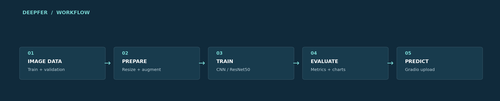
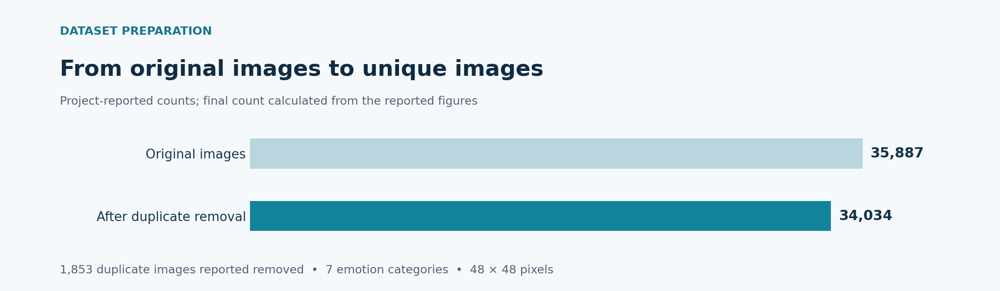
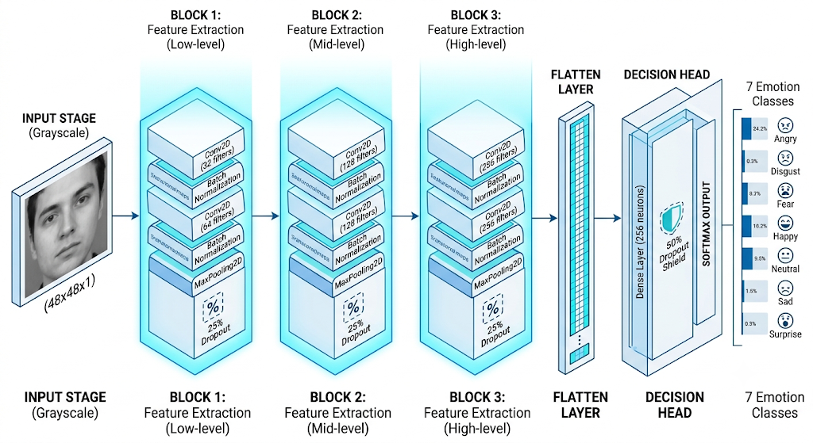

# DeepFER

### Facial expression recognition with deep learning

DeepFER is a computer vision project that classifies facial images into seven expression categories. The project covers everything from data preparation and image exploration through CNN training, a ResNet50 transfer-learning experiment, evaluation, and a Gradio image-upload interface.

[Open in Google Colab](https://colab.research.google.com/github/amol004/DeepFER-Facial-Emotion-Recognition-Using-Deep-Learning/blob/main/DeepFER_Facial_Emotion_Recognition_Using_Deep_Learning.ipynb) · [View the project code on GitHub](https://github.com/amol004/DeepFER-Facial-Emotion-Recognition-Using-Deep-Learning/blob/main/DeepFER_Facial_Emotion_Recognition_Using_Deep_Learning.ipynb)

---

## Project at a glance

| | Project detail |
|---|---|
| **Task** | Seven-class facial expression classification |
| **Input** | Grayscale facial images resized to 48 × 48 pixels |
| **Dataset** | 35,887 images reported for the project, organized into training and validation folders |
| **Model approaches** | Custom convolutional neural network (CNN) and a ResNet50 transfer-learning experiment |
| **Reported CNN accuracy** | **65%**, as reported in the project conclusion |
| **Interface** | Gradio image upload with the top three predicted classes |

The 65% figure is a project-reported result; the conclusion does not specify the evaluation split or run associated with it.

## What the project does

- Prepares and explores images across **angry, disgust, fear, happy, neutral, sad, and surprise** categories.
- Checks images and identifies duplicates using file hashes.
- Normalizes images and applies training-time augmentation, including horizontal flips and shifts.
- Builds a custom CNN and explores an ImageNet-initialized ResNet50 approach.
- Provides code for accuracy and loss curves, confusion matrices, and class-wise evaluation reports.
- Uses a Gradio interface to upload a face image and display the model's top predictions.

## How it works



1. **Organize the images.** The project reads labeled images from `train` and `validation` folders.
2. **Prepare the data.** Images are resized to 48 × 48, converted to grayscale, and scaled to the 0–1 range. Training images also receive random shifts and horizontal flips.
3. **Train the models.** A custom CNN learns visual features across three convolutional blocks. A separate ResNet50 section explores transfer learning.
4. **Review performance.** Training history, confusion matrices, and classification reports help examine predictions.
5. **Try an image.** The Gradio interface loads the custom CNN's saved weights and returns the three highest-scoring expression labels.

## Dataset and preparation

The project describes a dataset of **35,887 images** in seven categories, with images at **48 × 48 pixels**. The project reports that **1,853 duplicate images** were removed. Subtracting those reported figures gives **34,034 images** after duplicate removal.



The preparation workflow also includes image-dimension checks, a scan for unreadable images, class-distribution exploration, and examples from the training folders. The project uses the existing `train` and `validation` directories; the validation set is used during training and evaluation.

### Expression categories

| Angry | Disgust | Fear | Happy | Neutral | Sad | Surprise |
|:---:|:---:|:---:|:---:|:---:|:---:|:---:|
| 😠 | 🤢 | 😨 | 😄 | 😐 | 😢 | 😮 |

## Custom CNN architecture

The custom CNN uses three feature-extraction blocks followed by a classification head. Convolution layers learn image features, batch normalization supports training, and pooling reduces feature-map dimensions. Dropout is used in the blocks and classification head.



*Original architecture illustration from the project. The percentages shown at the output are illustrative, not reported evaluation results.*

| Stage | Configuration |
|---|---|
| Input | 48 × 48 × 1 grayscale image |
| Feature block 1 | Convolution layers with 32 and 64 filters, batch normalization, max pooling, 25% dropout |
| Feature block 2 | Two 128-filter convolution layers, batch normalization, max pooling, 25% dropout |
| Feature block 3 | Two 256-filter convolution layers, batch normalization, max pooling, 25% dropout |
| Classification head | Flatten, dense layer with 256 units, batch normalization, 50% dropout, seven-class softmax |
| Training | Adam optimizer at a learning rate of 0.0001; categorical cross-entropy; 50 configured epochs |
| Checkpoint | Saves the weights with the best validation accuracy |

## ResNet50 transfer-learning experiment

The project also defines a second model based on **ResNet50**. A 1 × 1 convolution adapts the grayscale input to three channels before it enters the ResNet50 base. The project loads ImageNet weights and adds global average pooling, a 512-unit dense layer, and a seven-class softmax output.

| Setting | Configuration |
|---|---|
| Input adaptation | 48 × 48 grayscale → three-channel representation |
| Base model | ResNet50 with ImageNet weight loading |
| Classification head | Global average pooling → Dense 512 → Dense 7 |
| Optimizer | Adam, learning rate 0.00001 |
| Training | 20 configured epochs; best weights selected by validation accuracy |

## Results and evaluation

The project reports **65% accuracy for the custom CNN**. It also describes a training dataset of more than **34,000 unique images** after duplicate removal.

For a detailed view of a training run, the project includes code to generate:

| Visualization or metric | What it shows |
|---|---|
| Training and validation accuracy curves | How accuracy changes across epochs |
| Training and validation loss curves | How the optimization loss changes across epochs |
| Confusion matrix | The relationship between actual and predicted expression classes |
| Classification report | Precision, recall, F1-score, and support for each class |

Run the corresponding Colab cells to generate these plots and reports for your training session.

## Try the project in Colab

1. Open [DeepFER in Colab](https://colab.research.google.com/github/amol004/DeepFER-Facial-Emotion-Recognition-Using-Deep-Learning/blob/main/DeepFER_Facial_Emotion_Recognition_Using_Deep_Learning.ipynb) and select a GPU runtime if available.
2. Place your dataset ZIP in Google Drive, mount Drive in Colab, and update `zip_path` to the ZIP's location.
3. Confirm that the extracted dataset matches the folder layout below, or update the code paths to match your files.
4. Run the data preparation, model definition, and training cells in order. The duplicate-cleanup cell removes files from the extracted dataset, so keep your original ZIP as a copy.
5. Run the evaluation cells to generate the charts and classification report. Run the Gradio cell after training the custom CNN to open the image-upload interface.

```text
my_dataset/
└── images/
    └── images/
        ├── train/
        │   ├── angry/  disgust/  fear/  happy/
        │   └── neutral/  sad/  surprise/
        └── validation/
            ├── angry/  disgust/  fear/  happy/
            └── neutral/  sad/  surprise/
```

The project uses TensorFlow/Keras, NumPy, pandas, scikit-learn, OpenCV, Pillow, Matplotlib, Seaborn, and Gradio. Install any missing packages in the Colab runtime before running the relevant cells.

## Project structure

```text
DeepFER-Facial-Emotion-Recognition-Using-Deep-Learning/
├── DeepFER_Facial_Emotion_Recognition_Using_Deep_Learning.ipynb
├── README.md
└── assets/
    ├── workflow.png
    ├── dataset-preparation.png
    └── cnn-architecture.png
```

## Technologies

**Deep learning:** TensorFlow · Keras · CNN · ResNet50  
**Data and image processing:** NumPy · pandas · OpenCV · Pillow  
**Evaluation and visualization:** scikit-learn · Matplotlib · Seaborn  
**Interface and environment:** Gradio · Google Colab

---

**Author:** [Amol Thakur](https://github.com/amol004)
